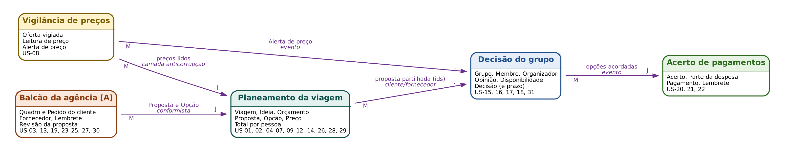

# Contextos delimitados e mapa de contextos — Roamly

O sistema divide-se em cinco contextos delimitados. Cada um tem a sua parte da linguagem ubíqua: o mesmo termo pode querer dizer coisas diferentes consoante o contexto, e é por isso que os contextos estão separados.

## 1. Contextos e o que cada um possui

| Contexto | Responsabilidade | Possui | Regras que garante | Histórias |
|---|---|---|---|---|
| **Planeamento da viagem** | Monta a proposta de viagem e diz quanto custa por pessoa. | Viagem (raiz do agregado), Ideia, Orçamento, Proposta, Opção (voo, alojamento, atividade), Preço e Total por pessoa. | O total por pessoa soma só as opções não cortadas e inclui o transporte até ao aeroporto; os extras que o site esconde aparecem «por confirmar», nunca são omitidos; o Roamly avisa quando o total passa o limite por pessoa. | US-01, 02, 04, 05, 06, 07, 09, 10, 11, 12, 14, 26, 28, 29 |
| **Vigilância de preços** | Volta a ler continuamente as ligações guardadas e avisa quando o preço sobe. | Oferta vigiada, Leitura de preço e Alerta de preço. | Um alerta mostra só de quanto o preço subiu, sem mensagens de urgência; se a oferta deixa de ser legível, avisa que o preço pode estar desatualizado; o Roamly não congela preços nem reserva. | US-08 (e a leitura automática das US-04 e US-05) |
| **Decisão do grupo** | Recolhe o que cada pessoa pensa e regista o que o grupo combinou. | Grupo, Membro, Organizador, Opinião, Disponibilidade e Decisão (com prazo). | Um grupo tem exatamente um organizador; o organizador vê em que itens há divergência e quem ainda não respondeu; a decisão fica registada mesmo que faltem respostas, e todos os membros a veem. | US-15, 16, 17, 18, 31 |
| **Acerto de pagamentos** | Calcula quanto cada pessoa deve e acompanha quem já pagou. | Acerto (raiz do agregado), Parte da despesa, Pagamento e Lembrete de pagamento. | Só o organizador marca um pagamento como feito; se alguém sai do grupo, as partes dos restantes são recalculadas; o Roamly regista pagamentos mas não os processa. | US-20, 21, 22 |
| **Balcão da agência [A]** | Dá ao agente de viagens um espaço de trabalho por cliente (só na versão para agências). | Quadro do cliente (raiz do agregado), Pedido do cliente, Lembrete no quadro, Fornecedor e Revisão da proposta. | O cliente não vê a proposta antes de o agente a assinar; um pedido com dados em falta é assinalado antes de se montar a proposta; um fornecedor sem preço aparece «sem preço», nunca como 0 €. | US-03, 13, 19, 23, 24, 25, 27, 30 |

## 2. Termos que mudam de significado

| Termo | Contexto | Significado |
|---|---|---|
| **Proposta** | Planeamento da viagem | O que se monta: um conjunto de opções com preços e total por pessoa, partilhado numa só ligação e sempre atualizado. |
|  | Decisão do grupo | O que o grupo avalia: é só referida por identificador; sobre ela os membros dão opinião e disponibilidade e dela sai a decisão. |
|  | Acerto de pagamentos | Não existe como proposta: só as opções acordadas interessam, e transformam-se em partes da despesa. |
|  | Balcão da agência | Um documento no modelo da agência, com logótipo, que o cliente só vê depois de o agente o assinar. |
| **Membro** | Decisão do grupo | Pessoa do grupo que dá opinião e indica datas; o organizador é o membro com o papel de planear. |
|  | Acerto de pagamentos | Devedor de uma parte da despesa; não pode marcar pagamentos. |
|  | Vigilância de preços | Destinatário dos alertas de preço. |
|  | Balcão da agência | Não existe: quem recebe a proposta é o cliente, que não faz parte de nenhum grupo. |
| **Opção** | Planeamento da viagem | Item com preço e estado: candidata, cortada (riscada mas visível) ou acordada. |
|  | Vigilância de preços | Uma oferta vigiada: uma ligação guardada com as leituras de preço feitas. |
|  | Decisão do grupo | Aquilo sobre que se opina (IdDaOpção); o que a opção é não interessa. |
|  | Acerto de pagamentos | Uma opção acordada é um custo a dividir pelo grupo. |
| **Preço** | Planeamento da viagem | Preço final: base mais extras (ex.: bagagem de porão), por pessoa. |
|  | Vigilância de preços | Uma leitura num dado momento; só importa a diferença para a anterior. |
|  | Acerto de pagamentos | O montante devido por cada membro (ex.: 98 €). |
| **Total por pessoa / Parte da despesa** | Planeamento da viagem | Total por pessoa: estimativa que muda sempre que um item muda e se compara com o limite. |
|  | Acerto de pagamentos | Parte da despesa: valor fixado depois de as opções serem acordadas, com o total que o organizador tem de adiantar. |
| **Reservar** | Decisão do grupo e Acerto | O Roamly não reserva: «reservar» é o organizador sair do Roamly e reservar no site do fornecedor. |

## 3. Relações entre contextos

M = a montante (fornece), J = a jusante (consome).

| A montante | A jusante | Relação | O que passa | Histórias |
|---|---|---|---|---|
| Vigilância de preços | Planeamento da viagem | Camada anticorrupção (no Planeamento) | Os preços lidos nos sites passam a ser o Preço de uma Opção; se a página não for legível, o organizador preenche à mão. | US-04, 05, 08 |
| Planeamento da viagem | Decisão do grupo | Cliente/Fornecedor | A proposta partilhada; a Decisão do grupo só guarda IdDaProposta e IdDaOpção e vê sempre a versão atualizada. | US-14, 15, 16 |
| Vigilância de preços | Decisão do grupo | Evento publicado | O Alerta de preço chega a todos os membros do grupo, haja ou não prazo. | US-08 |
| Decisão do grupo | Acerto de pagamentos | Evento publicado | As opções acordadas dão origem às partes da despesa. | US-18, 20 |
| Balcão da agência | Planeamento da viagem | Conformista | A agência usa Proposta e Opção tal como o Planeamento as define e acrescenta revisão, assinatura e fornecedores; o preço das ofertas guardadas chega-lhe por aqui. | US-13, 23, 30 |
| Todos | Todos | Núcleo partilhado (pequeno) | Dinheiro e identificadores (IdDoGrupo, IdDoMembro, IdDaProposta, IdDaOpção). | — |
